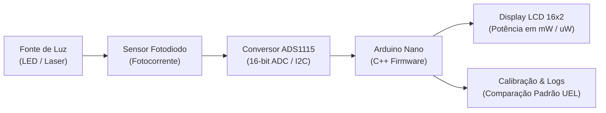

# 🔬 Medidor Secundário para Potência Luminosa de LEDs e Lasers

[](#)
[](#)
[](#)
[](#)

> Projeto de Iniciação Científica desenvolvido no **Laboratório de Óptica e Optoeletrônica** da **Universidade Estadual de Londrina (UEL)**, vinculado ao projeto de pesquisa *"Aprendizado de Linguagens Científicas"* sob orientação do **Prof. Dr. Edson Laureto**.

---

## 🎯 Visão Geral do Projeto

Equipamentos comerciais para medição de potência óptica (potenciômetros ópticos de precisão) costumam ser importados e de custo proibitivo para bancadas de ensino e prototipagem rápida. 

Este projeto teve como objetivo o **desenvolvimento completo de um instrumento eletrônico de bancada de baixo custo** para aferição de potência luminosa emitida por fontes de estado sólido (LEDs e lasers). O sistema integra captação óptica por fotodiodo, conversão analógica-digital de alta resolução, processamento em microcontrolador, calibração matemática por comprimento de onda e interface gráfica em display alfanumérico.



---

## ⚙️ Arquitetura e Componentes

| Componente | Função no Sistema |
| :--- | :--- |
| **Microcontrolador** | Arduino Nano (ATmega328P), executando firmware em C++ otimizado para amostragem contínua. |
| **Conversor A/D (ADC)** | **ADS1115** (16 bits de resolução, interface I2C com ganho programável - PGA), garantindo leitura precisa de microvolts. |
| **Interface Visual** | Display LCD 16×2 com módulo I2C para exibição direta das medições e modo de seleção espectral. |
| **Eletrônica & PCB** | Esquemático e roteamento desenvolvidos no **KiCad**. |
| **Gabinete & Chassi** | Gabinete customizado modelado no **FreeCAD** e materializado via **Impressão 3D (PLA/PETG)** com blindagem contra luz espúria. |

---

## 📊 Calibração Espectral e Algoritmo

Fotodiodos possuem resposta espectral não-linear (responsividade variável em $A/W$ para cada comprimento de onda $\lambda$). Para garantir precisão, o firmware implementa lookup tables e equações de calibração aferidas empiricamente contra o **equipamento de referência de bancada do laboratório** para os comprimentos de onda:

- **375 nm** (Região do ultravioleta próximo)
- **405 nm** (Violeta / Diodo laser)
- **488 nm** (Azul / Linha de laser de argônio)
- **520 nm** (Verde / Laser DPSS / diodo)

### Otimizações no Código C++:
- **Filtro de média móvel exponencial** para eliminar ruído térmico e oscilações da rede de 60 Hz nas leituras do ADS1115.
- Minimização de operações em ponto flutuante dentro do loop principal, garantindo tempo de resposta instantâneo na tela.

---

## 🤖 Uso de Inteligência Artificial no Fluxo de Desenvolvimento

Neste projeto, ferramentas de IA generativa e de análise computacional foram incorporadas como **alavanca de produtividade e validação científica**:

1. **Ajuste de Curvas e Regressão:** Scripts auxiliares em Python foram acelerados com assistência de IA para cruzar os dados brutos de tensão do ADS1115 contra a potência lida no medidor comercial padrão da UEL, gerando os fatores de correção implementados em C++.
2. **Refatoração e Boas Práticas em C++:** Revisão da modularização do código para separar a camada de hardware (drivers I2C/ADS) da camada de lógica de calibração.
3. **Cálculo de Incerteza e Propagação de Erro:** IA utilizada para checar fórmulas de desvio padrão e incerteza combinada das medições ópticas.

---

## 📁 Estrutura do Repositório

```text
├── firmware/             # Código-fonte em C++ (.ino / .cpp / .h)
│   ├── power_meter.ino   # Loop de amostragem e controle
│   └── calibration.h     # Tabelas de calibração por comprimento de onda
├── hardware/             # Arquivos de eletrônica e esquemáticos KiCad
├── cad/                  # Modelos 3D (.step, .fcstd, .stl) para impressão 3D
├── analysis/             # Scripts em Python para tratamento dos dados de calibração
└── docs/                 # Relatórios técnicos e notas de bancada
```

---

## 👩‍💻 Autoria e Orientação

- **Desenvolvido por:** Beatriz Cristina Vaz — Graduanda em Ciência da Computação (UEL)
- **Orientação:** Prof. Dr. Edson Laureto — Laboratório de Óptica e Optoeletrônica / Departamento de Física (UEL)
